

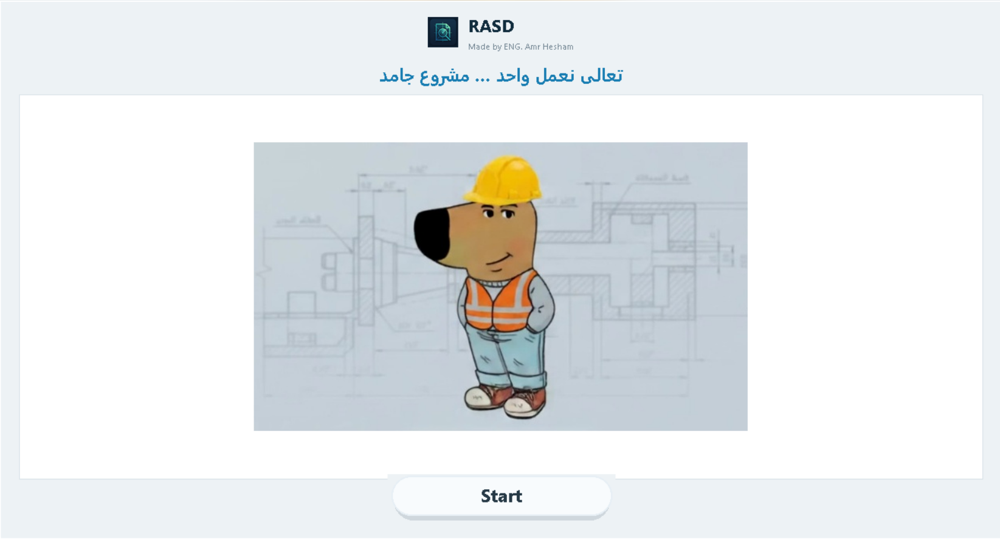

# رَاصِد | RASD

### مشاريعك الهندسية وملفاتك ومهامك… في مكان واحد وعلى جهازك.

[English](README.md) · **العربية**

---

## 💡 إيه هو راصد؟

**راصد** برنامج مكتبي للمهندسين والمكاتب الهندسية اللي شغلهم كله فولدرات مليانة رسومات وPDF وشيتات حسابات.

بدل ما تفضل تدور جوه فولدرات جوه فولدرات، راصد **بيعمل فهرسة لفولدر كل مشروع**، وبيخليك **تدور بسرعة**، و**تعاين الملفات من غير ما تفتحها**، وبيربط **المهام والتقويم** بالمشروع اللي تابعة له.

كل حاجة بتفضل **على جهازك**. من غير حساب ولا سحابة ولا اشتراك.

  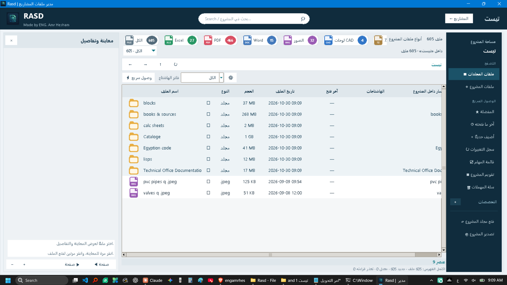

---

## ✨ المميزات

### 📁 مستكشف المشروع والفهرسة
- فهرسة فولدر المشروع كله وتصفحه بشكل سريع ومألوف.
- **عدادات لأنواع الملفات** (Excel, PDF, Word, صور, لوحات CAD…) بضغطة واحدة.
- **هاشتاجات وتخصصات** (زي `#ري`) لتجميع الفولدرات حسب التخصص.
- **وصول سريع:** المفضلة، آخر ما فتحته، أضيف حديثًا، وسجل التغييرات لكل مشروع.
- **سلة مهملات** لكل مشروع: استرجاع أو حذف نهائي.

### 🔎 بحث فوري
- بحث بالاسم أو المسار أو الامتداد أو الهاشتاج داخل المشروع.
- **حفظ عمليات البحث** لاستخدامها لاحقًا.
- النتائج بتتحدث وإنت بتكتب.

### 👁️ معاينة مدمجة
- معاينة **الصور وملفات PDF ولوحات DWG** في اللوحة الجانبية من غير ما تسيب البرنامج.
- بيانات الملف كاملة: الحجم، النوع، المجلد، تاريخ التعديل، آخر فتح، الهاشتاجات.
- ضغطة واحدة للمعاينة، ضغطتين للفتح.

### ✅ مهام وتقويم ذكي
- **مهام مرتبطة بالمشروع** مع أولوية وتاريخ ووقت وهاشتاجات.
- **قائمة خطوات تنفيذ** داخل كل مهمة مع نسبة إنجاز مباشرة (مثلاً `0/3`).
- **مزامنة ثنائية مع ملف TXT:** كل مهمة هي كمان ملف نصي داخل المشروع، وتقدر تعدل من أي طرف.
- **عرض التقويم:** شهر · أسبوع · يومي · أجندة.
- **اسحب وأفلت** لتغيير ميعاد المهمة، واسحب الحافة السفلية لتغيير مدتها، وانقر على مساحة فارغة لإضافة مهمة (بخطوات 15 دقيقة).
- **طباعة وتصدير PDF** لقائمة المهام.

### 🔐 الخصوصية والصيانة
- **كلمة مرور اختيارية** عند بدء البرنامج.
- **تصدير / استيراد المشاريع** للنسخ الاحتياطي أو المشاركة.
- **مسار حفظ مخصص** للبيانات، مع إمكانية استعادة الافتراضي.
- **فحص التحديثات** من إصدارات GitHub.

---

## 📸 لقطات الشاشة

<table>
  <tr>
    <td width="50%">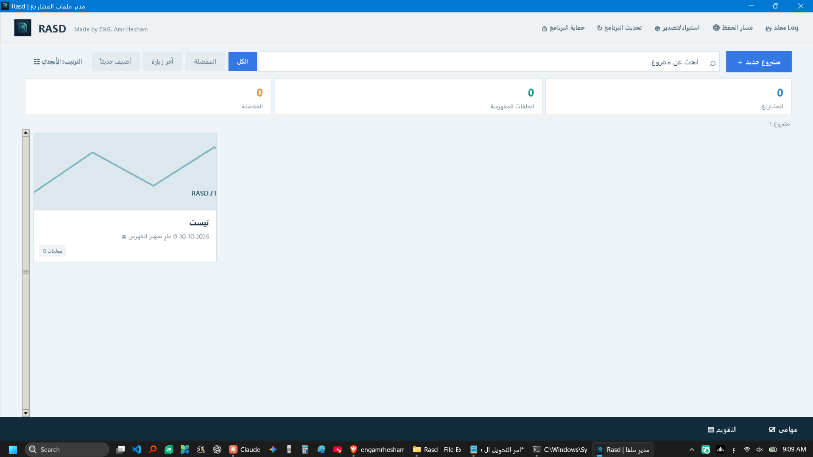 <b>الرئيسية</b></td>
    <td width="50%">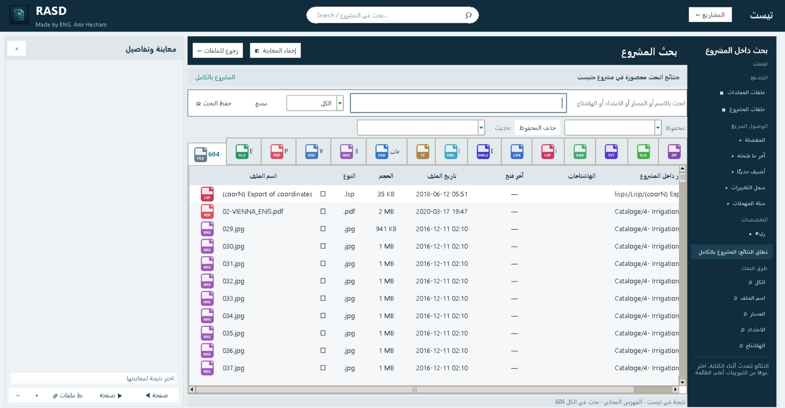 <b>البحث</b></td>
  </tr>
  <tr>
    <td>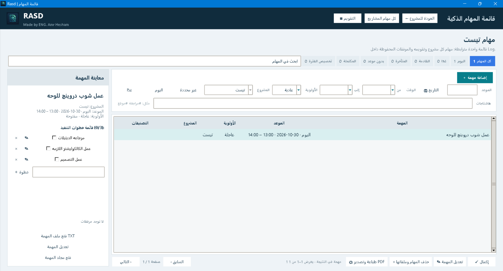 <b>قائمة المهام الذكية</b></td>
    <td>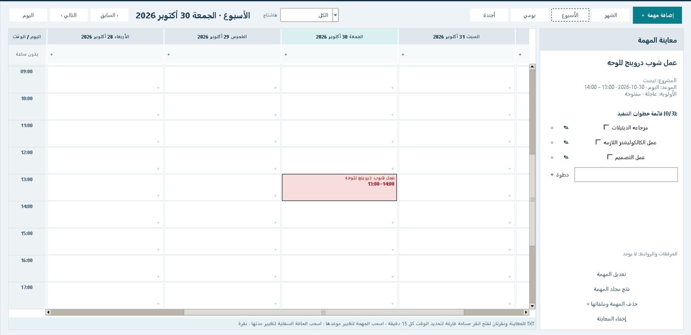 <b>التقويم الأسبوعي</b></td>
  </tr>
  <tr>
    <td>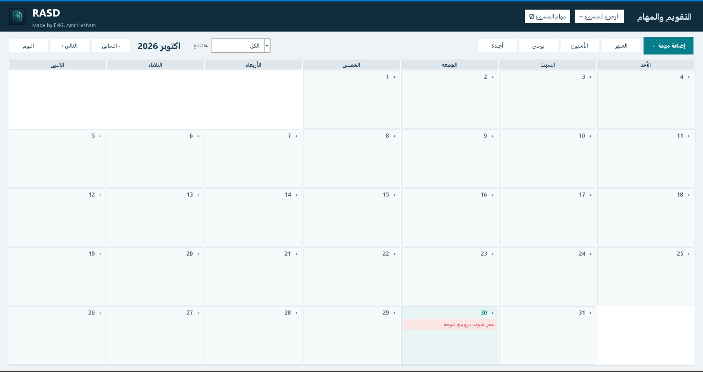 <b>التقويم الشهري</b></td>
    <td>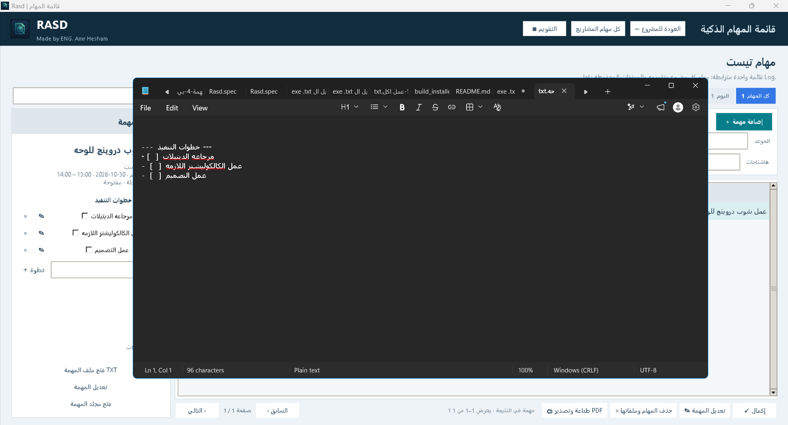 <b>مزامنة TXT ثنائية الاتجاه</b></td>
  </tr>
  <tr>
    <td>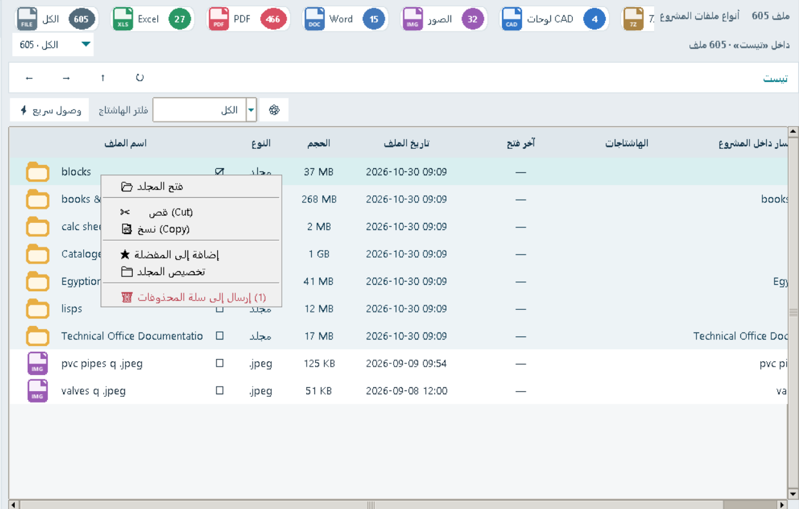 <b>قائمة الزر الأيمن</b></td>
    <td>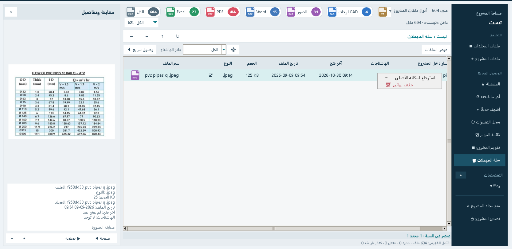 <b>سلة المهملات</b></td>
  </tr>
</table>

<b>المزيد من اللقطات</b>

 

<table>
  <tr>
    <td width="33%">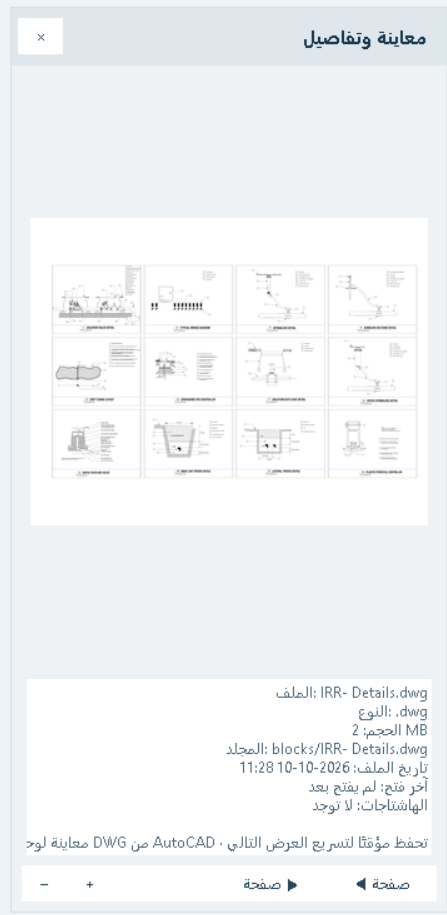 معاينة DWG / صور / PDF</td>
    <td width="33%">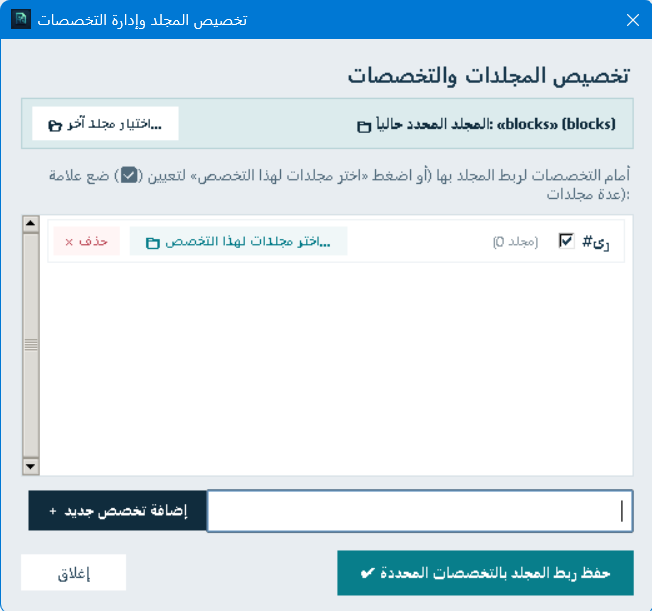 التخصصات</td>
    <td width="33%">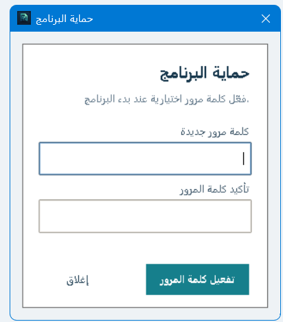 حماية البرنامج</td>
  </tr>
  <tr>
    <td>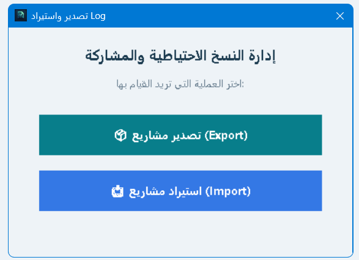 تصدير / استيراد</td>
    <td>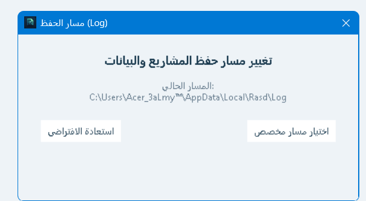 مسار الحفظ</td>
    <td>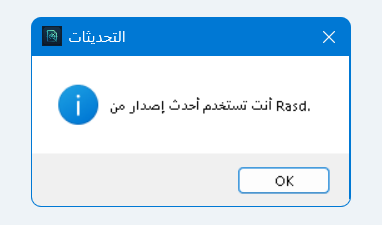 التحديثات</td>
  </tr>
</table>

---

## 🚀 البداية

### التثبيت (الطريقة الموصى بها)

1. ادخل على صفحة [**Releases**](https://github.com/engamrhesham2002-cell/Rasd/releases/latest).
2. نزّل آخر نسخة (ملف التثبيت / `.exe`).
3. شغّله واضغط **Start**.
4. اضغط **مشروع جديد**، اختار فولدر المشروع، وسيب راصد يعمل الفهرسة.

> **المتطلبات:** ويندوز 10 أو 11.

### جولة سريعة

| عايز… | اعمل كده |
|---|---|
| تضيف مشروع | **مشروع جديد +** من الشاشة الرئيسية |
| تدور على ملف | شريط البحث أو صفحة بحث المشروع |
| تعاين ملف | اضغط عليه مرة واحدة |
| تفتح ملف | اضغط عليه مرتين |
| تضيف مهمة | **مهامي** (الشريط السفلي) ← **إضافة مهمة** |
| تغير ميعاد مهمة | اسحبها في التقويم |
| تعمل نسخة احتياطية | **استيراد/تصدير** أعلى الشاشة الرئيسية |

---

## 🛠️ التقنيات المستخدمة

| | |
|---|---|
| **اللغة** | Python 3.10+ |
| **الواجهة** | Tkinter مع عناصر مخصصة |
| **قاعدة البيانات** | SQLite3 مع بحث نصي FTS5 |
| **البنية** | كلاسات مقسمة بنظام Mixins |
| **اللغة** | واجهة عربية (RTL) |

---

## 🗺️ خطة التطوير

- [ ] إعادة تصميم كاملة للواجهة *(جاري العمل)*
- [ ] خيار واجهة إنجليزية
- [ ] معاينة لأنواع ملفات أكتر

---

## 🤝 الملاحظات والمساهمة

لقيت مشكلة أو عندك فكرة؟ [افتح Issue](https://github.com/engamrhesham2002-cell/Rasd/issues) وأي رأي مرحب بيه.

---

## 👨‍💻 المطوّر

**م. عمرو هشام**
مهندس زراعي (هندسة نظم حيوية) · مهتم بالبرمجة
GitHub: [@engamrhesham2002-cell](https://github.com/engamrhesham2002-cell)

---

  اتعمل بحب للمهندسين اللي عايزين يصمموا مش يدوروا في الفولدرات.

