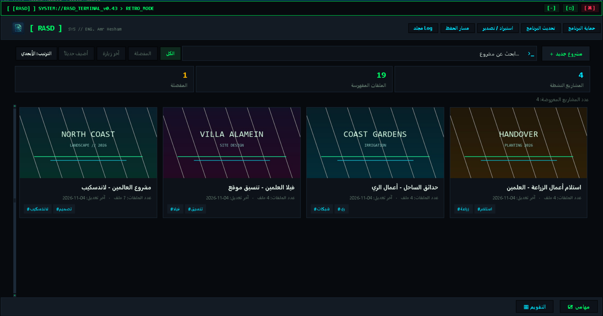
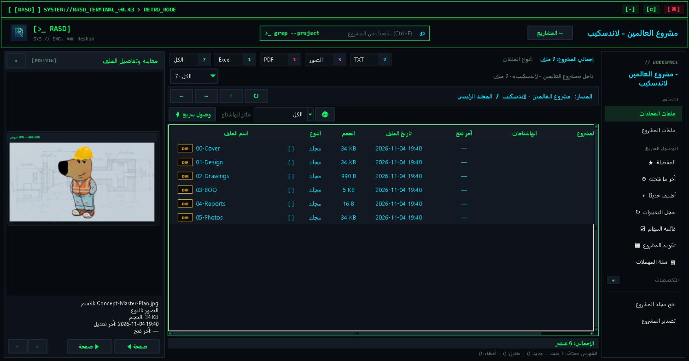
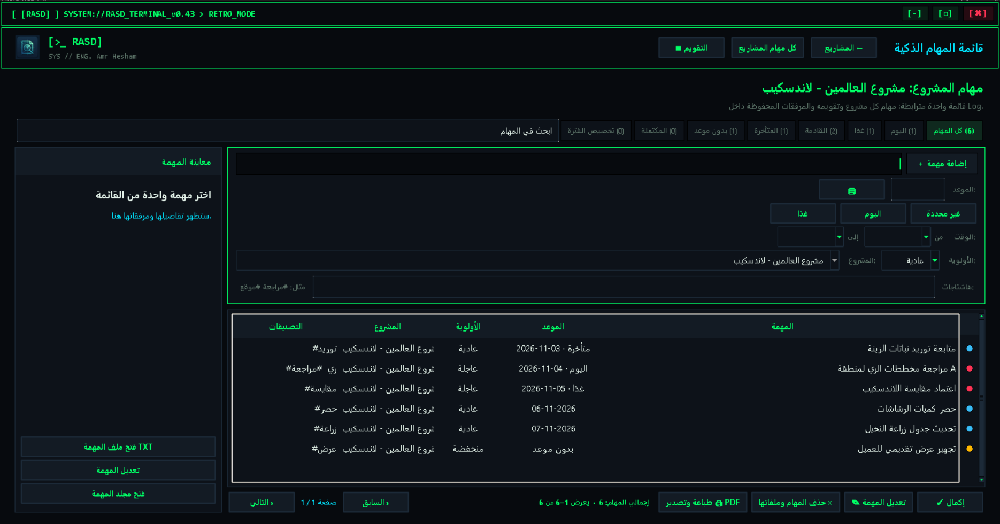
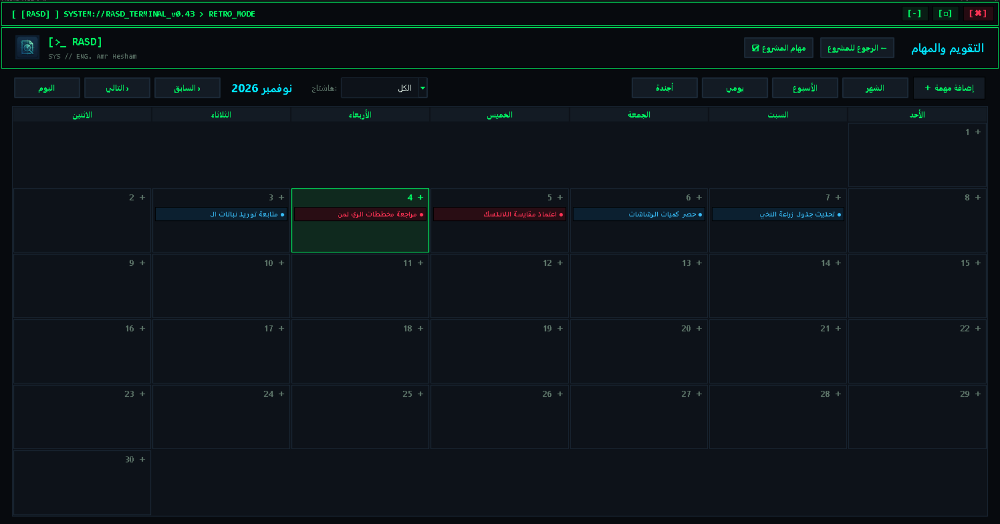
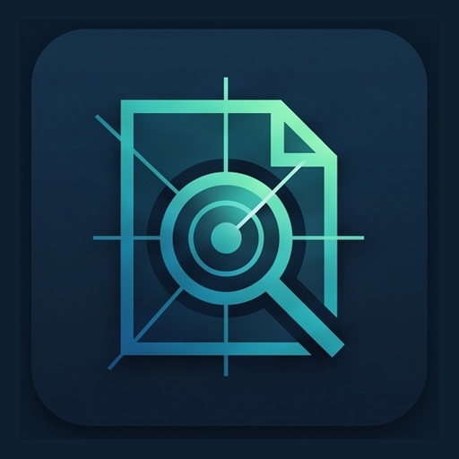

<p align="center">
  
</p>

<p align="center">
  
  
  
  
  
</p>

<h3 align="center">مركز قيادة المكتب الفني: مشاريعك، ملفاتك، مهامك، وبكاباتك — في تطبيق واحد.</h3>

<p align="center">
  <a href="https://github.com/engamrhesham2002-cell/Rasd/releases/latest"><b>⬇ تحميل آخر إصدار</b></a>
  &nbsp;·&nbsp;
  <a href="#التثبيت-والتشغيل"><b>طريقة التثبيت</b></a>
  &nbsp;·&nbsp;
  <a href="#المطور"><b>عن المطور</b></a>
</p>

<p align="center">
  
</p>

---

## رصد إيه؟

**رصد (RASD)** تطبيق سطح مكتب عربي مبني خصيصًا لشغل **المكاتب الفنية واللاندسكيب**. بيجمع كل حاجة محتاجها وأنت شغال على مشروع في مكان واحد:

- مشاريعك وملفاتها على الجهاز، مرتبة وقابلة للبحث في ثواني.
- معاينة سريعة للملفات من غير ما تفتح كل برنامج.
- مهام ومواعيد وتقويم مرتبطين بالمشاريع.
- هاشتاجات وتخصصات ومفضلة وسلة محذوفات.
- نسخ احتياطي كامل، وحماية بكلمة مرور، وتحديثات من GitHub.

كل البيانات محفوظة **على جهازك** داخل قاعدة بيانات محلية — مفيش رفع سحابي ولا حساب ولا اشتراك.

> **الفكرة باختصار:** أقل تنقل بين المجلدات والبرامج، وأكتر وقت في الشغل نفسه.

---

## لمين البرنامج؟

- مهندسين زراعيين ومهندسي لاندسكيب في المكاتب الفنية.
- مشاريع التصميم والتنسيق والتشغيل والاستلام.
- أي حد بيدير عدد كبير من الملفات والمراجعات والمهام اليومية لمشروع أو أكتر.
- الفرق الصغيرة اللي بتحتاج أداة خفيفة تشتغل بدون إنترنت وبدون تعقيد.

---

## المميزات

### 🗂 إدارة المشاريع
- إنشاء مشروع لكل موقع أو فيلا أو مرحلة، بكارت مستقل ومساحة عمل منفصلة.
- أغلفة للمشاريع، هاشتاجات، عدد الملفات، وتاريخ آخر تعديل.
- مفضلة، بحث فوري، فرز بالأحدث أو الأبجدي، وفلاتر «الكل / المفضلة / آخر زيارة / أضيف حديثًا».
- «تنويم» المشروع لإخفائه مؤقتًا من الواجهة، أو حذف نهائي مع تأكيد.
- شاشة إحصائيات سريعة: المشاريع النشطة، الملفات المفهرسة، والمفضلة — وبتتحدث لحظيًا بعد أي حذف.

### 📁 مستكشف ملفات احترافي
- عرض شجري للمجلدات أو عرض مسطح لكل ملفات المشروع.
- فرز بالاسم، الحجم، التاريخ، النوع، وآخر فتح.
- معاينة داخلية لـ **الصور، PDF، Excel وCSV، Word، DXF، النصوص والأكواد**، مع تكبير وتنقل بين صفحات PDF.
- دعم **DWG** عند توفر محول ODA على الجهاز.
- نسخ / قص / لصق، حذف لمجموعة ملفات، وسلة محذوفات داخلية لاسترجاع اللي اتحذف.
- فتح الملف بالبرنامج الافتراضي، وإظهار معلوماته وحجمه وتاريخ آخر فتح.
- روابط ذكية بين الملفات المرتبطة (نسخ المراجعات، المرفقات، الملفات المتشابهة).
- هاشتاجات لكل ملف + تخصصات للمجلدات + مفضلة للملفات والمجلدات.

<p align="center">
  
</p>

### 🔎 بحث سريع
- تكامل مع **Everything** للبحث الفوري في أسماء الملفات (اختياري — البرنامج شغال بدونه).
- محرك بحث داخلي بديل يعتمد على SQL، ونتايج مطابقة لنفس البحث.
- بحث بالاسم، المسار، الامتداد، أو الهاشتاج.
- فلاتر حسب نوع الملف، بحث محفوظ، وسجل بحث لكل مشروع.
- عرض النتايج على دفعات عشان المشاريع الكبيرة تفضل سريعة.

### ✅ مهام ذكية وتقويم
- شاشة مهام لكل مشروع أو لكل المشاريع معًا، مع فلاتر: الكل، اليوم، غدًا، القادمة، المتأخرة، بدون موعد، المكتملة.
- إدخال سريع بمختصرات: `!1` للأولوية، `#هاشتاج` للتصنيف، وكلمات مثل «اليوم» و«غدًا» أو تاريخ `YYYY-MM-DD`.
- تاريخ ووقت للمهمة، أولوية، مشروع، هاشتاجات، ومرفقات.
- خطوات فرعية (Subtasks) وتكرار يومي / أسبوعي / شهري.
- تقويم بعرض الشهر والأسبوع واليوم والأجندة.
- تصدير وطباعة قائمة المهام من خلال صفحة جاهزة للطباعة أو حفظها PDF.
- تنبيهات بصرية للمهام المتأخرة والمستحقة اليوم.

<p align="center">
  
</p>

<p align="center">
  
</p>

### 💾 نسخ احتياطي واستيراد
- تصدير المشاريع في ملف ZIP واحد، مع خيار ضم المهام.
- استيراد نسخة احتياطية مع اختيار **الدمج** أو **الاستبدال**.
- التحقق من سلامة المسارات أثناء الاستيراد لمنع أي ملفات خارج مجلد المشاريع.

### 🔐 حماية وخصوصية
- قفل اختياري بكلمة مرور عند فتح البرنامج.
- كل البيانات محلية في `%LOCALAPPDATA%\Rasd\Log`.
- التحقق من شهادة TLS عند جلب أيقونات المواقع.
- التحقق من بصمة **SHA-256** لأي تحديث قبل تثبيته.
- حماية من هجمات **Zip-Slip** عند استيراد النسخ الاحتياطية.

### 🎨 واجهة عربية بثيم الطرفية
- واجهة RTL كاملة بخطوط وألوان ثيم التيرمينال الداكن.
- نوافذ حوار وقوائم منسدلة وأشرطة تمرير داكنة ومتناسقة.
- شريط عنوان داكن مخصص، وأزرار تكبير/تصغير/إغلاق بنفس الهوية.
- تصميم متجاوب مع أحجام الشاشات المختلفة.

### ⚙️ الإعدادات والمظهر
- زر **إعدادات** دائم في شريط العنوان يظهر في كل الشاشات.
- تبديل فوري بين **العربية** و**English** لكل الواجهة، مع تحويل اتجاه التصميم تلقائيًا.
- ثلاثة ثيمات: **Matrix** (الأخضر الكلاسيكي)، **أبيض**، و**أسود**.
- **لون مميز** قابل للتغيير في الثيمين الأبيض والأسود (قوالب جاهزة + منتقي ألوان).
- كل الإعدادات تُحفظ محليًا وتُطبَّق لحظة التغيير بدون إعادة تشغيل.

### 🖼️ أغلفة المشاريع
- كليك يمين على أي مشروع → **تعيين صورة للمشروع** من أي مكان على الجهاز.
- الصورة تُنسخ داخل بيانات البرنامج وتُعرض على كارت المشروع، مع خيار إزالتها والعودة للغلاف التلقائي.

### 🗂️ إنشاء وإضافة مباشرة من الإكسبلورر
- كليك يمين على مساحة فارغة → **مجلد جديد** بتسمية مثل ويندوز مع التحقق من الأسماء غير المسموح بها.
- **إضافة ملف...** لاختيار ملفات من أي مكان ونسخها إلى المجلد الحالي مع تفادي تكرار الأسماء وتسجيلها في سجل النشاط.

### ⚡ أداء
- فهرسة SQLite بفهارس محسّنة لكل المشاريع.
- فحص تفاضلي (Incremental): يكتب الملفات الجديدة أو المتغيرة فقط.
- عرض الملفات ونتايج البحث على دفعات بدل تجميد الواجهة.
- كاش لملخصات الصفحة الرئيسية، وتنظيف دوري للسجلات القديمة.
- تحميل المكتبات الثقيلة (PDF/Excel/Word/CAD) عند الحاجة فقط، لبدء تشغيل أسرع.

---

## الجديد في الإصدار v0.44.3

- **إصلاح تهنيج/انهيار البرنامج عند فتح ملفات PDF كبيرة (100 ميجابايت أو أكثر) أو لوحات CAD ضخمة**: كان حساب مقياس رسم صفحة PDF يفرض حدًا أدنى `0.35`، فإذا كانت الصفحة مرسومة بأبعاد هندسية هائلة (وهو شائع في لوحات CAD المصدَّرة PDF) ينتج `pixmap` بمليارات البكسلات يستهلك كل ذاكرة الجهاز ويجعل البرنامج "Not Responding" ثم يُغلق.
- **سقف صارم لرسم PDF**: المقياس الآن يُحسب من أبعاد الصفحة مع حد أقصى 1600 بكسل للضلع و4 ملايين بكسل للصفحة، بدون أي حد أدنى. صفحة CAD بعرض 200,000 نقطة كانت تحتاج 3.7 مليار بكسل (≈11 جيجابايت) وأصبحت 760×570 بكسل.
- **قراءة DWG محدودة الذاكرة**: لم يعد البرنامج يقرأ ملف DWG كاملًا (كان يقرأ 100+ ميجابايت في الذاكرة ليبحث عن صورة المعاينة المضمنة)؛ يمسح أول 32 ميجابايت فقط. ملف 120 ميجابايت جُرّب: 0.04 ثانية وبذاكرة 33 ميجابايت بدل تحميل الملف كله.
- **تخطي الرسم عبر AutoCAD تلقائيًا** للوحات DWG الأكبر من 80 ميجابايت (مع استخدام المعاينة المضمنة أو مصغرات Windows) لتجنّب الانتظار الطويل.
- **حماية DXF الكبير**: ملفات DXF الأكبر من 45 ميجابايت تعرض بطاقة توضيحية وزر الفتح الخارجي بدل تحليلها كاملة.
- **حماية الصور الضخمة**: الصور التي تتجاوز حدود الذاكرة الآمنة لا تُفكّ ضغطها في المعاينة أو في شريط الملفات المرتبطة، ولا تُحمَّل صور ضخمة على خيط الواجهة.
- النتيجة: فتح ملف PDF بحجم 120 ميجابايت أو صفحة بأبعاد 200,000×150,000 نقطة لا يوقف الواجهة (أقصى تأخر مقاس 59 مللي ثانية) ويعرض المعاينة في أقل من ثانية.

## الجديد في الإصدار v0.44.2

- **إصلاح مكان أزرار الرجوع/التقدم/الأعلى/التحديث** في الإكسبلورر عند التحويل للإنجليزية: كانت الأزرار تنعكس وتنتقل لليمين بترتيب مقلوب وتُقصّ أحيانًا. أصبحت الآن على اليسار بنفس الترتيب `← → ↑ ↻` في العربية والإنجليزية، والمسار يمتد بعدها، مع تحاذٍ صحيح حسب اتجاه اللغة.
- **ترتيب ثابت لفلتر الهاشتاج وفلاتر تاريخ النشاط** في الإنجليزية (العنوان ثم القائمة ثم زر الإعدادات) بدل الترتيب المقلوب.
- الأزرار أصبحت أصغر قليلًا حتى تظهر كاملة دائمًا حتى لو كان جزء المعاينة مفتوحًا وضاقت مساحة الشريط.
- تحسينات داخلية في طبقة الترجمة تسمح لأي شريط بتثبيت اتجاه ترتيبه مع بقاء عكس المحاذاة.

## الجديد في الإصدار v0.44.1

- **إصلاح جذري لعطل التحديث التلقائي** على أسماء المستخدمين التي تحتوي رموزًا خاصة (مثل `™`): كان مساعد التحديث القديم يُقرأ بترميز خاطئ فيتحول المسار إلى `â„¢` وتظهر نافذة `find` سوداء عالقة.
- **مساعد تحديث جديد بالكامل** بـ PowerShell بترميز ASCII خالص، يقرأ المسارات من ملف JSON بترميز UTF-8، وينتظر إغلاق البرنامج ثم يثبّت التحديث ويعيد فتحه **بدون أي نوافذ**.
- **تنظيف تلقائي** لملفات المساعد القديم وأي طلب تحديث معلّق عند بدء التشغيل.
- عند فشل التثبيت يعيد المساعد فتح النسخة الحالية ويظهر تنبيه بدل أن يترك البرنامج مغلقًا.

> **مهم:** لو عندك **v0.43**، نزّل `RasdSetup.exe` من هذا الإصدار وشغّله **مرة واحدة يدويًا**، لأن v0.43 نفسها تحتوي المساعد القديم المعطوب. بعد كده التحديثات التلقائية تعمل عادي.

## الجديد في الإصدار v0.44

- **زر إعدادات دائم** في شريط العنوان بجانب اسم البرنامج، ظاهر في كل الشاشات.
- **تبديل اللغة عربي / إنجليزي** فورًا: كل النصوص والقوائم والتبويبات والنوافذ، مع عكس اتجاه التصميم (RTL ↔ LTR) تلقائيًا، وأسماء المشاريع والملفات والبيانات تفضل كما هي.
- **ثلاثة ثيمات**: Matrix، أبيض، أسود — مع **لون مميز** قابل للتخصيص في الأبيض والأسود (قوالب + منتقي ألوان).
- **صورة مخصصة لكل مشروع** عن طريق كليك يمين على كارت المشروع، مع إمكانية إزالتها.
- **إنشاء مجلد جديد** من مساحة فارغة في الإكسبلورر بنفس أسلوب ويندوز.
- **إضافة ملف** من أي مكان على الجهاز ونسخه إلى المجلد الحالي.
- حفظ كل الإعدادات محليًا وتطبيقها لحظيًا بدون إعادة تشغيل.

## الجديد في الإصدار v0.43

- إصلاح ظهور زر **«غدًا»** كاملًا داخل شاشة المهام في كل أحجام النوافذ.
- تحديث **عدّاد المشاريع والملفات والمفضلة** فورًا بعد الحذف النهائي أو حذف مجموعة مشاريع.
- توحيد **كل النوافذ والقوائم المنسدلة وأشرطة التمرير والحواف** على الثيم الداكن.
- إدارة **هاشتاج ملف واحد**: إضافة وحذف فردي بدل مسح الكل.
- تحسين شاشة المهام عند **عدم وجود مشاريع** بحالة واضحة وأزرار فعّالة.
- تسريع الفحص والعرض والبحث، وإضافة كاش للصفحة الرئيسية.
- حماية إضافية للتحديثات والنسخ الاحتياطية.
- إصلاح التكرار الشهري للمهام في نهايات الشهور (31 يناير ← 28/29 فبراير).
- تقسيم شاشة المهام داخليًا لملفات أصغر + طبقة قراءة بيانات مركزية، بدون أي تغيير في الشكل أو طريقة الاستخدام.

---

## التثبيت والتشغيل

### 1) تحميل المثبّت
من صفحة [Releases](https://github.com/engamrhesham2002-cell/Rasd/releases/latest) نزّل ملف:

```
RasdSetup.exe
```

### 2) التثبيت
شغّل `RasdSetup.exe` واتبع الخطوات. المثبّت:

- بيثبّت البرنامج في `%LOCALAPPDATA%\Programs\Rasd` — **بدون صلاحيات مدير**.
- بيعمل اختصار على سطح المكتب وفي قائمة ابدأ.
- بيسيب مشاريعك وبياناتك زي ما هي عند التحديث فوق نسخة قديمة.
- بيظهر في **Settings → Apps** ويمكن إزالته من هناك.

> لو ظهرت رسالة **Windows SmartScreen** (لأن التطبيق غير موقّع تجاريًا): اضغط **More info** ثم **Run anyway**.

### 3) أول تشغيل
- افتح **Rasd** من الاختصار.
- أنشئ أول مشروع وابدأ.

### 4) التحديث التلقائي
لو عندك **v0.44.1** أو أحدث، مش محتاج تنزّل أي حاجة يدويًا:

- البرنامج بيفحص GitHub لوحده وبيقولك لما يبقى فيه إصدار جديد.
- لما تختار **«حدّثني الآن»** بينزّل `RasdSetup.exe` الجديد، بيتحقق من بصمة الملف، ويثبّته في نفس المكان ثم يفتح البرنامج تلقائيًا.
- بياناتك ومشاريعك مش بتتأثر بالتحديث.

> لو عندك **v0.43** أو **v0.44**، نزّل `RasdSetup.exe` من إصدار v0.44.1 وشغّله مرة واحدة يدويًا؛ النسختان دي على مسارات المستخدمين اللي فيها `™` عندها مساعد التحديث القديم المعطوب. بعد التثبيت مرة واحدة، التحديثات التلقائية تعمل طبيعي.

### متطلبات التشغيل
- Windows 10 أو Windows 11 (64-bit).
- لا يحتاج Python أو أي مكتبات على جهاز المستخدم.
- **Everything** اختياري لتسريع البحث؛ البحث الداخلي شغال بدون أي إعداد.
- الإنترنت مطلوب فقط للتحقق من التحديثات.

### فين بياناتي؟
كل شيء بشكل افتراضي داخل:

```
%LOCALAPPDATA%\Rasd\Log
```

فيه قاعدة البيانات، ملفات المشاريع، سجل النشاط، والنسخ المؤقتة. خد نسخة احتياطية دورية من داخل البرنامج (استيراد/تصدير) قبل أي نقل للجهاز.

---

## البناء من المصدر

### المتطلبات
- Python **3.11**
- Git
- Windows 10/11

### الخطوات

```bat
git clone https://github.com/engamrhesham2002-cell/Rasd.git
cd Rasd
py -3.11 -m pip install -r requirements-dev.txt
py -3.11 -m PyInstaller Rasd.spec --noconfirm --clean
```

الناتج:

```
dist\Rasd\Rasd.exe
```

### بناء ملف التثبيت (RasdSetup.exe)

محتاج **NSIS 3** مرة واحدة:

```bat
winget install -e --id NSIS.NSIS
```

وبعدها من مجلد المشروع:

```bat
makensis /DAPP_VERSION=0.44.3 build_installer.nsi
```

الناتج:

```
release\RasdSetup.exe
```

أو بضغطة واحدة: شغّل **`build.bat`** للنسخة الخام، و**`release.bat`** لبناء المثبّت ورفعه على GitHub.

> المثبّت هو الملف اللي بيستخدمه التحديث التلقائي داخل البرنامج. لازم يتحطّ كملف `.exe` واحد في الـ Release، وليس ZIP.

### سكربتات مساعدة

| الملف | الوظيفة |
|---|---|
| `build.bat` | تثبيت متطلبات البناء وتوليد نسخة `dist\Rasd` |
| `build_installer.nsi` | سكربت NSIS اللي بيحوّل مجلد `dist\Rasd` إلى `RasdSetup.exe` |
| `push.bat` | رفع الكود إلى GitHub مع فرع احتياطي عند اختلاف التاريخ |
| `release.bat` | بناء التطبيق + بناء `RasdSetup.exe` + رفع Release جديد على GitHub بضغطة واحدة |

> `release.bat` يحتاج **GitHub Token** بصلاحية `repo` (أو Fine-grained token بصلاحية Contents: Read and write)، ويحتاج **NSIS** مثبت مرة واحدة. الملف بيشرح الخطوات وبيسمح بحفظ التوكن على جهازك لتسهيل المرات القادمة.
>
> الملف المرفوع اسمه ثابت `RasdSetup.exe` — وده مهم لأن `updates.py` بيدوّر على أول ملف `.exe` في الـ Release وينزّله ويشغّله بوضع صامت `/SILENT`.

---

## التقنيات المستخدمة

| التقنية | الاستخدام |
|---|---|
| Python 3.11 + Tkinter | واجهة سطح المكتب (عربي RTL / إنجليزي LTR) |
| SQLite (WAL) | قاعدة البيانات المحلية والفهارس والبحث |
| PyMuPDF / pypdf | معاينة ملفات PDF |
| openpyxl / xlrd / pyxlsb | معاينة Excel وCSV |
| python-docx | معاينة ملفات Word |
| ezdxf | معاينة ملفات DXF |
| Pillow | الصور والأغلفة والأيقونات |
| Send2Trash | حذف آمن لسلة المحذوفات |
| Everything | بحث فوري اختياري |
| PyInstaller | بناء نسخة Windows مستقلة |
| NSIS | توليد ملف التثبيت `RasdSetup.exe` والتحديث الصامت |

### هيكل المشروع (مختصر)

| الملف | المسؤولية |
|---|---|
| `rasd_app.py` | تهيئة التطبيق والثيم والنوافذ |
| `theme.py` | الثيمات الثلاثة ومحرك نشر الألوان واللون المميز |
| `i18n.py` / `i18n_data.py` | محرك الترجمة عربي/إنجليزي وقاموس النصوص |
| `localize_ui.py` | طبقة ترجمة Tk/ttk والقوائم والجداول وعكس الاتجاه |
| `settings_ui.py` | نافذة الإعدادات وزرها الدائم في شريط العنوان |
| `home.py` | الشاشة الرئيسية وإدارة المشاريع وأغلفتها |
| `explorer.py` | مستكشف الملفات والمعاينة |
| `search.py` | البحث ومحركاته |
| `tasks_*.py` | المهام والتقويم والتفاصيل |
| `storage.py` | قاعدة البيانات والفهارس |
| `sync_ops.py` | التصدير والاستيراد |
| `security.py` | قفل البرنامج |
| `updates.py` | التحديثات من GitHub |
| `tests/` | الاختبارات التلقائية |

### الاختبارات

```bat
py -3.11 -m unittest discover -s tests -q
```

---

## المطور

<table>
  <tr>
    <td width="120" align="center">
      
    </td>
    <td>
      <h3>م. عمرو هشام — Amr Hesham</h3>
      <p><b>مهندس زراعي مصري · المكتب الفني والتصميم</b></p>
    </td>
  </tr>
</table>

أنا **عمرو هشام**، مهندس زراعي مصري، شغال في **المكتب الفني**، وحاليًا في **مشاريع العلمين — الساحل الشمالي — دفعة 2026**.

عندي شغف وحب كبير لشغل **التصميم والمكتب الفني للاندسكيب**، وبحب أبني أدوات تساعدني في شغلي اليومي بمساعدة **الذكاء الاصطناعي**. برنامج **رصد** بدأ من احتياج حقيقي في المكتب: ملفات كتير، مراجعات، مهام، ونسخ احتياطية — فقررت أجمعها في أداة واحدة خفيفة وسريعة وبنفس الهوية اللي بحبها.

- 🐙 GitHub: [github.com/engamrhesham2002-cell](https://github.com/engamrhesham2002-cell)
- 💼 LinkedIn: [Amr Hesham Mahmoud Zaki](https://www.linkedin.com/in/amr-hesham-mahmoud-zaki-06a786406/)
- 📦 المشروع: [github.com/engamrhesham2002-cell/Rasd](https://github.com/engamrhesham2002-cell/Rasd)

لو عندك اقتراح أو لقيت مشكلة، افتح **Issue** أو تواصل معي على LinkedIn.

---

## شكر وتقدير

- [Everything](https://www.voidtools.com/) من voidtools — محرك البحث السريع (الترخيص مرفق داخل `Assets/Everything-License.txt`).
- كل مكتبات Python مفتوحة المصدر المستخدمة في المشروع.
- **الذكاء الاصطناعي** كشريك في التصميم والبرمجة والتوثيق.

---

<p align="center">
  <b>RASD — رصد</b><br>
  صُنع بحب في مصر 🇪🇬 للمكاتب الفنية واللاندسكيب.
</p>

<p align="center">
  © 2026 عمرو هشام. جميع الحقوق محفوظة.
</p>
