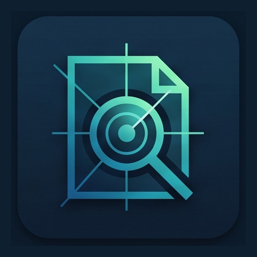
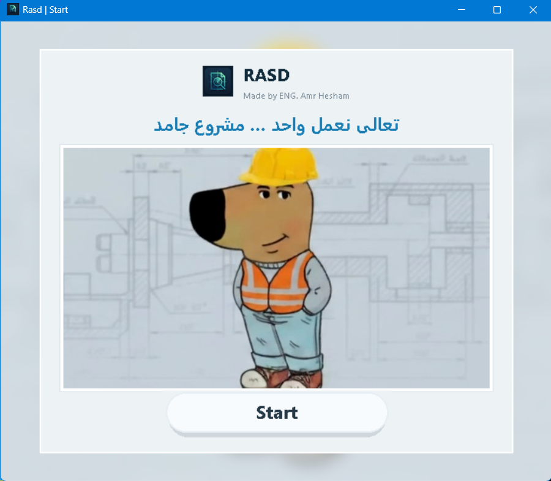
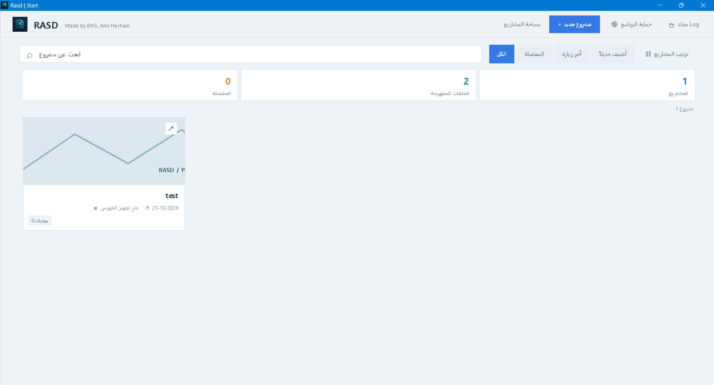
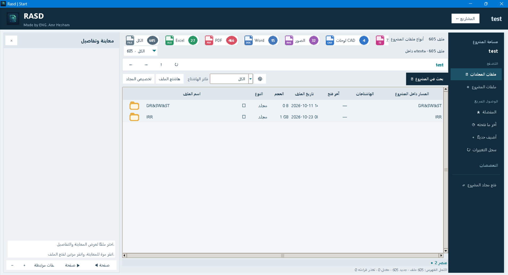
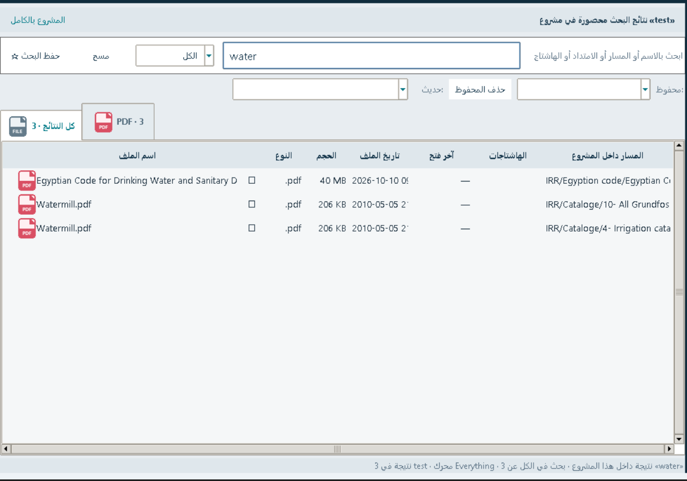
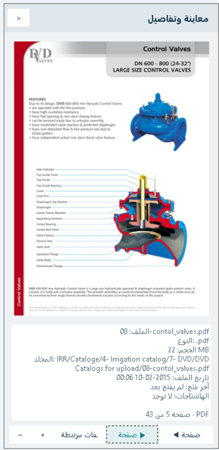
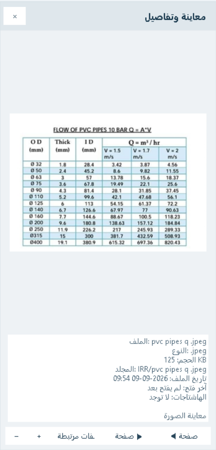
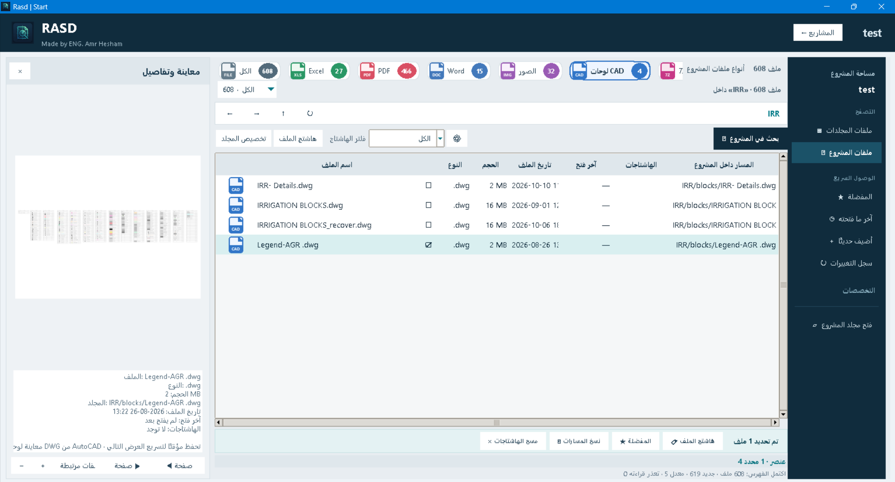
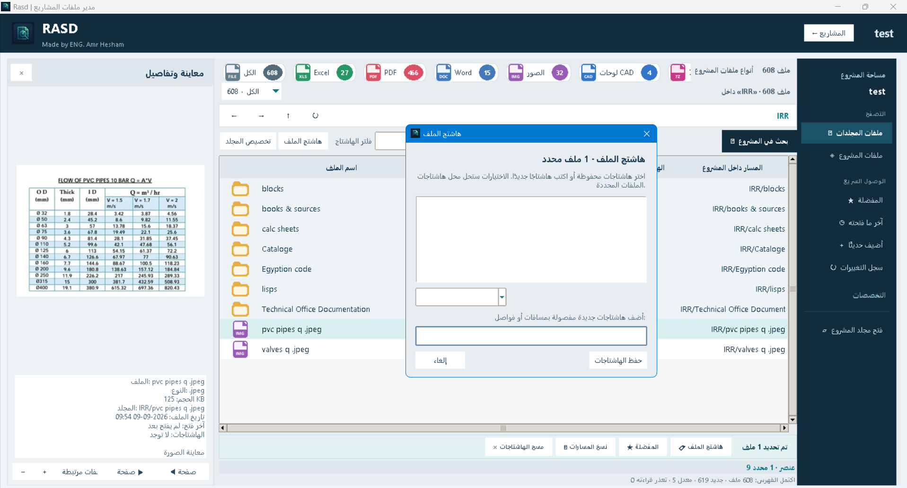
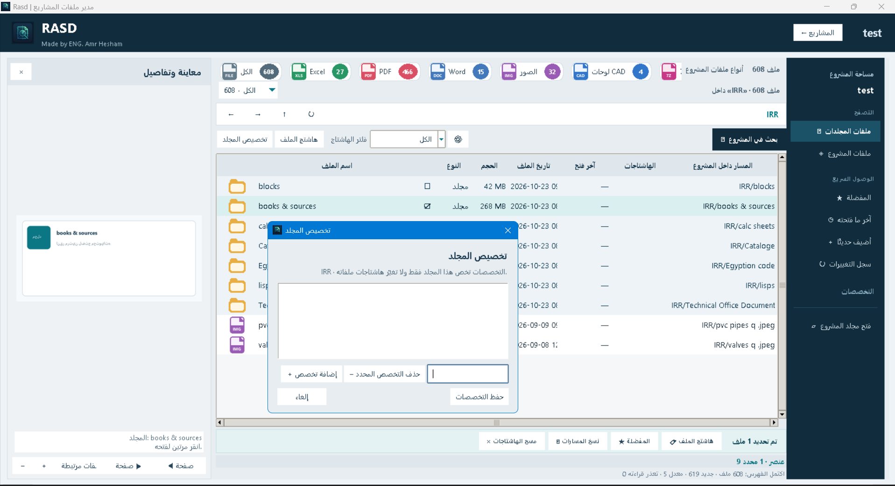

  
  <h1>Rasd | رَصْد</h1>
  
<strong>Project file manager for engineering and technical-office work</strong>

  
مدير ملفات المشروعات الهندسية وأعمال المكتب الفني

  

    <a href="https://github.com/engamrhesham2002-cell/Rasd/releases"><strong>⬇ Download Rasd from Releases</strong></a>
    &nbsp;·&nbsp;
    <a href="#overview-ar">العربية</a>
    &nbsp;·&nbsp;
    <a href="#overview-en">English</a>
  

  

  
<em>Made by ENG. Amr Hesham · صنعه م. عمرو هشام</em>

---

## Contents | الفهرس

- [نبذة عن Rasd](#overview-ar)
- [مميزات البرنامج](#features-ar)
- [التنزيل والتشغيل](#download-ar)
- [صور من البرنامج](#screenshots-ar)
- [ملاحظات وحدود المعاينة](#notes-ar)
- [الترخيص](#license-ar)
- [ما القادم؟](#roadmap-ar)
- [كلمة من المطور](#about-author-ar)
- [About Rasd](#overview-en)
- [Features](#features-en)
- [Download and run](#download-en)
- [Screenshots](#screenshots-en)
- [Preview notes and limitations](#notes-en)
- [What’s next?](#roadmap-en)
- [About the developer](#about-author-en)

## نبذة عن Rasd

**Rasd (رَصْد)** برنامج ويندوز يساعد على تنظيم ملفات المشروعات الهندسية والمكتبية والبحث فيها ومعاينة أنواع متعددة منها من واجهة واحدة. صممته عشان يسهل عليّ وعلى زملائي الوصول لملفات المشروع اليومية.

> **التنزيل:** [افتح صفحة الإصدارات Releases](https://github.com/engamrhesham2002-cell/Rasd/releases) واختر النسخة المناسبة. رابط الإصدارات سيظل ثابتًا مع التحديثات.

## مميزات البرنامج

- إنشاء المشروعات وتصفح مجلداتها وملفاتها من واجهة واحدة.
- بحث داخل المشروع المفتوح باستخدام محرك **Everything** المضمّن، مع بحث محلي احتياطي عند تعذر تشغيل المحرك.
- تصفية الملفات حسب النوع والامتداد، وعرض معلومات الملف وموقعه وحجمه.
- معاينة الصور وPDF وملفات Excel وDOCX والملفات النصية، ومعاينة DXF. معاينة DWG تعتمد على توفر معاينة مناسبة أو أدوات AutoCAD على الجهاز.
- إضافة هاشتاجات للملفات وتخصصات للمجلدات، وحفظ المفضلة.
- الوصول إلى الملفات التي فُتحت مؤخرًا والملفات التي أضيفت حديثًا وسجل نشاط البرنامج.
- تثبيت اختياري لكلمة مرور لفتح البرنامج. كلمة المرور لا تشفر ملفات المشروع.

## التنزيل والتشغيل

نزّل ملف التثبيت من [صفحة Releases](https://github.com/engamrhesham2002-cell/Rasd/releases). النسختان القياسية والمحمولة تضمان Python ومكتبات البرنامج ومحرك Everything، لذلك لا تحتاج لتثبيت Python أو تنزيل مكونات وقت التشغيل من الإنترنت.

- **Standard installer:** يتيح اختيار مجلد التثبيت، وينشئ مجلد `Log` بجوار البرنامج.
- **Portable installer:** ينشئ مجلدًا محمولًا بجوار ملف التثبيت؛ انقل المجلد كاملًا بعد إغلاق البرنامج، مع إبقاء `Rasd.exe` و`Log` معًا.
- أنشئ كل مشروع داخل مجلد مستقل ضمن `Log` بجوار البرنامج. يقتصر البحث على المشروع المفتوح.

### للمطورين

يتوفر الكود المصدري المقسّم ونسخة كاملة مدمجة في [`source/v0.38`](source/v0.38). تعليمات البناء ومتطلباته موجودة في مجلد النسخة. المشروع مبني بـPython 3.11 وTkinter؛ راجع ملفات المصدر والتراخيص المرفقة قبل إعادة التوزيع.

## صور من البرنامج

  
  

  
  

  
  
  

  
  

## ملاحظات وحدود المعاينة

- معاينة PDF وExcel داخل البرنامج مخصصة للعرض؛ لا تعدّل ملفات المصدر ولا تعيد حساب معادلات Excel.
- معاينة DWG ليست مضمونة على كل جهاز؛ تعتمد على وجود ملف PDF أو صورة مرتبطة، أو صورة مصغرة من Windows، أو AutoCAD Core Console متاح.
- معاينة Excel تعرض البيانات على صفحات، وقد لا تظهر نتائج المعادلات إذا لم تكن محفوظة داخل الملف.
- فتح الملفات خارجيًا يعتمد على البرامج المثبتة وارتباطات الملفات في Windows.
- ملفات المشروع تبقى ملفات عادية داخل `Log`، وقفل البرنامج الاختياري لا يشفرها.

## الترخيص

كود Rasd منشور بموجب **AGPL-3.0**؛ راجع ملف [`LICENSE`](LICENSE). راجع [`THIRD_PARTY_NOTICES.md`](THIRD_PARTY_NOTICES.md) لتراخيص المكونات المضمّنة، ومنها Everything وPyMuPDF.

## ما القادم؟

دي أفكار للتطوير في الإصدارات القادمة، ومش كلها متاحة حاليًا:

1. معاينة الفيديوهات بصيغ مختلفة.
2. تحسين تكبير وتصغير المعاينة وتحريكها بسلاسة.
3. نظام مرن لربط ملفات المشروع ببعضها وإدارة الملفات المرتبطة بلوحة CAD.
4. قائمة مهام داخل البرنامج.
5. تقويم للمهام والمواعيد.
6. اختصارات لمواقع العمل المهمة.
7. اختصارات للبرامج المستخدمة في العمل.
8. تحسين شكل الواجهة وتجربة الاستخدام.

## كلمة من المطور

أنا عمرو هشام محمود، مهندس مكتب فني في مجال الري والصرف الزراعي واللاندسكيب. أنا مش مبرمج؛ استخدمت أدوات الذكاء الاصطناعي في إنشاء Rasd، وكان دوري طرح الأفكار وتوجيه الأدوات للوصول لبرنامج يساعدني في شغلي. كنت أتمنى أدرس حاسبات ومعلومات، لكن الظروف ما سمحتش وقتها. بإذن الله هسعى أتعلم البرمجة لما ألاقي الوقت المناسب، وهكمل تطوير أدوات تساعدني وتساعد زملائي.

ما بنسبش لنفسي فضل كتابة الكود، وبشكر مطوري **Everything** على محرك البحث الممتاز اللي ألهمني وأستخدمه داخل Rasd للبحث في ملفات المشروع. هدفي إني أطور البرنامج مع الوقت وأشاركه مع الآخرين.

## About Rasd

**Rasd (رَصْد)** is a Windows application for organizing, searching, and previewing engineering and technical-office project files from one place. I built it to make everyday project files easier for me and my colleagues to find.

> **Download:** Visit the [GitHub Releases page](https://github.com/engamrhesham2002-cell/Rasd/releases) and choose the installer that fits your needs. This link remains stable across updates.

## Features

- Create projects and browse their folders and files in one interface.
- Search within the open project using the bundled **Everything** engine, with a local fallback if the engine cannot run.
- Filter files by type and extension, and view file details and project paths.
- Preview images, PDFs, Excel workbooks, DOCX, and text files, plus DXF drawings. DWG preview depends on suitable previews or AutoCAD tools being available on the computer.
- Add file hashtags and folder specialties, and save favorites.
- Revisit recently opened files, recently added files, and activity recorded by the application.
- Optional password prompt when opening the app. It does not encrypt project files.

## Download and run

Download an installer from the [Releases page](https://github.com/engamrhesham2002-cell/Rasd/releases). Both the standard and portable installers bundle Python, the application libraries, and Everything, so users do not need to install Python or download runtime components.

- **Standard installer:** lets you choose an installation folder and creates a `Log` folder beside the app.
- **Portable installer:** creates a portable folder beside the installer. Close Rasd before moving that complete folder, and keep `Rasd.exe` and `Log` together.
- Create each project in its own subfolder inside `Log`, which is beside the application. Search is scoped to the open project.

### For developers

The split source modules and the merged single-file source are in [`source/v0.38`](source/v0.38). Build instructions and requirements are included there. Rasd uses Python 3.11 and Tkinter; review the source and accompanying third-party licenses before redistribution.

## Screenshots

The screenshots above show the welcome screen, project dashboard, file browser, project search, and representative previews and organization tools.

## Preview notes and limitations

- PDF and Excel previews are for viewing; they do not edit the original file or recalculate Excel formulas.
- DWG preview is not guaranteed on every computer. It depends on a related PDF/image, a Windows thumbnail, or an available AutoCAD Core Console.
- Excel data is shown in pages; formula results may be absent when they are not saved in the workbook.
- Opening files externally depends on applications installed and Windows file associations.
- Project files remain ordinary files in `Log`; the optional application password does not encrypt them.

## License

Rasd is licensed under **AGPL-3.0**; see [`LICENSE`](LICENSE). See [`THIRD_PARTY_NOTICES.md`](THIRD_PARTY_NOTICES.md) for bundled component notices, including Everything and PyMuPDF.

## What’s coming?

These are ideas for future versions; they are not all available yet:

1. Preview videos in different formats.
2. Smoother preview zoom and panning.
3. A flexible way to link project files and manage files associated with CAD drawings.
4. An in-app to-do list.
5. A calendar for tasks and appointments.
6. Shortcuts to important work websites.
7. Shortcuts to work applications.
8. Continued improvements to the interface and user experience.

## About the developer

I’m Amr Hesham Mahmoud, a technical-office engineer working in agricultural irrigation, drainage, and landscaping. I’m not a programmer; I used AI tools to build Rasd. My part was to bring the ideas and guide those tools toward something useful for my work. I had hoped to study computer science, but circumstances did not allow it at the time. I hope to learn programming in the future and keep building tools that help me and my colleagues.

I don’t claim credit for writing the code. I’m grateful to the developers of **Everything** for their excellent search engine, which inspired me and is used by Rasd to search within a project. I hope to keep improving the application and sharing it with others.

---

**Rasd · Made by ENG. Amr Hesham**

